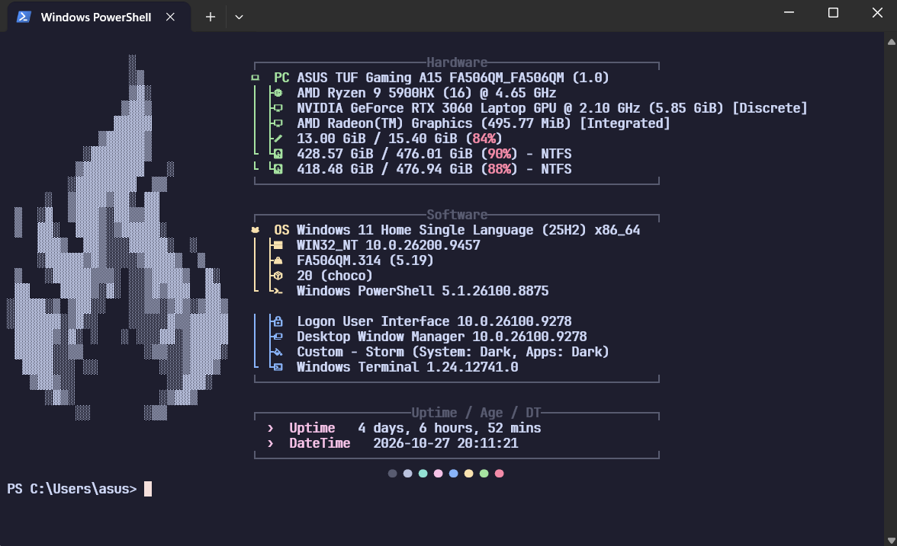

# Customize Your Windows Terminal

Give your default Windows Terminal a clean, customized look with a custom font, PowerShell profile, and Fastfetch.

## Preview



## Step 1: Configure Windows Terminal

1. Open **Windows Terminal** or **PowerShell**.
2. Click the arrow next to the tab bar to open the menu.

   [IMAGE]

3. Select **Settings**.
4. Scroll to the bottom of the Settings sidebar and open the **JSON file**.

   [IMAGE]

5. Copy the configuration files provided in this repository into the appropriate locations, following the files and instructions in the repo.
6. Download the font used by this setup and install it on your system.

## Step 2: Configure Your PowerShell Profile

1. Open Windows Terminal or PowerShell.
2. Run this command to find the profile path for the current PowerShell session:

   ```powershell
   $PROFILE
   ```

3. PowerShell will show the path to your profile script (`.ps1`). If the file does not exist yet, create it at the displayed location.
4. Return to this repository and copy the code from `profile.ps1` into your PowerShell profile.
5. Replace the username in the script with your own Windows username, then save the file.

## Step 3: Install and Configure Fastfetch

1. Install Fastfetch with WinGet:

   ```powershell
   winget install fastfetch
   ```

   You can also visit the [Fastfetch GitHub repository](https://github.com/fastfetch-cli/fastfetch).

2. Open the Fastfetch configuration directory:

   ```text
   C:\Users\your_username\.config\fastfetch
   ```

   Replace `your_username` with your Windows username. If the `fastfetch` folder does not exist, create it.

3. Copy these repository files into the `fastfetch` folder:
   - `ascii.txt`
   - `config.jsonc`

4. Open `config.jsonc`, replace `yourUsername` with your Windows username, and save the file.

## Finished!

Open a new tab in Windows Terminal to see the customized setup.

[IMAGE]

## Troubleshooting

If PowerShell displays an error saying that script execution is disabled on this system, open PowerShell and run:

```powershell
Set-ExecutionPolicy -ExecutionPolicy RemoteSigned -Scope CurrentUser -Force
```

This changes the execution policy for your current user. You generally do not need to open PowerShell as Administrator for the `CurrentUser` scope.

---

If you find this guide useful, feel free to ⭐ the repository!
